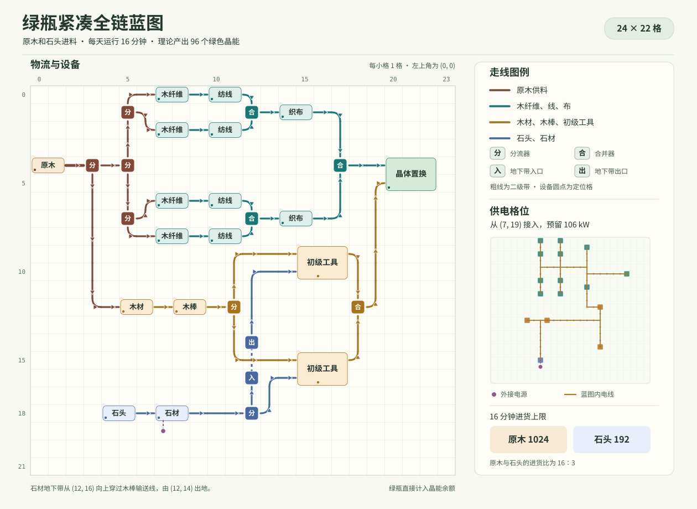

# 绿瓶蓝图｜紧凑原料全链

这套蓝图按指定 Steam 存档的科技设计。**提供原木、石头和电力，基础理论产量每分钟 6 个绿色晶能。** 两种原料从各自的自动进货箱进入，木材、木棒、石材、木纤维、线、布和初级工具全部在线内制作。产出的绿瓶直接计入绿色晶能余额。

[打开蓝图导入文本](../blueprints/green-crystal-raw-6pm.txt)

## 放置和开工

1. 复制导入文本的全部内容，在游戏的蓝图界面打开「导入蓝图」，粘贴并确认。蓝图在列表中显示为「绿色晶能·紧凑全链」。
2. 预留 **24 × 22 格**的空地。预览方向为原木箱在左上、石头箱在左下、晶体置换机在右上。自动完成蓝图需要 **116 个建造胶囊**和下表中的建材。
3. 左上进货箱装**原木**，左下进货箱装**石头**。分别指定林场和石矿配送，或按日配额手动装料。
4. 在石材制造机下方的格位 `(7, 19)` 接入电线，给电网留出 **106 kW**。该产线无需用水。晶体置换机预设为「绿色晶能生产」，产出计入绿色晶能余额。

## 每日进货

| 进货口 | 原料 | 每分钟耗料 | 每日补货上限（16 分钟） |
| --- | --- | ---: | ---: |
| 左上 `(0, 4)` | 原木 | 64 | **1024** |
| 左下 `(4, 18)` | 石头 | 12 | **192** |

**原木∶石头 = 16∶3，对应理论日产 96 个绿瓶。** 原木在同一箱进入，稳定运行时每天约 768 个用于做布、256 个用于做初级工具，分支的实际耗料比为 **3∶1**。每日补货量按 100% 速率、无生产加速、满负荷运行 16 分钟计算。料箱有剩余库存时，按余额补足日用量。

## 产能与设备

| 工序 | 机器 | 单机每分钟产量 | 维持每分钟 6 绿瓶需要 |
| --- | --- | ---: | ---: |
| 原木 → 木纤维 | 制造机 ×4 | 30 | 72 木纤维 |
| 木纤维 → 线 | 制造机 ×4 | 10 | 36 线 |
| 线 → 布 | 制造机 ×2 | 10 | 18 布 |
| 原木 → 木材 | 制造机 ×1 | 20 | 16 木材 |
| 木材 → 木棒 | 制造机 ×1 | 30 | 24 木棒 |
| 石头 → 石材 | 制造机 ×1 | 20 | 12 石材 |
| 木棒、石材 → 初级工具 | 组装机 ×2 | 6 | 12 初级工具 |
| 布、初级工具 → 绿色晶能 | 晶体置换机 ×1 | 6 | 6 绿色晶能 |

四台木纤维机各接一台制线机，两组制布线路分别汇合。原木入口用一格二级带承担 64 件/分钟的进料，其余地面输送用一级带。一对一级地下带让石材穿过木棒输送线。配方、设备额定供电和物流标称速度取自本机 Steam 安装版。 [来源与验证状态](research.md#绿瓶蓝图)

## 紧凑化结果

| 指标 | 旧版 | 紧凑版 |
| --- | ---: | ---: |
| 占地 | 34 × 29 格 | **24 × 22 格** |
| 建筑数及胶囊用量 | 188 | **116** |
| 电线 | 92 | **64** |
| 木板 | 165 | **93** |
| 木棒 | 326 | **182** |
| 铜线 | 208 | **152** |

对比过 3 台木纤维机共用干线的方案。保留第 4 台使木纤维机与制线机一对一连接，能缩掉共用干线和额外分合流。选用的排法占地更小、组件更少，额定功耗比三台方案高 4 kW。 [方案对比记录](research.md#紧凑版与日进货量)

## 建造清单

| 部件 | 数量 |
| --- | ---: |
| 自动进货箱 | 2 |
| 一级传送带 | 85 |
| 二级传送带 | 1 |
| 一级地下传送带 | 2 个端点 |
| 分流器 | 6 |
| 合并器 | 4 |
| 制造机、组装机、晶体置换机 | 13、2、1 |
| 电线 | 64 |

| 建材 | 数量 | 建材 | 数量 |
| --- | ---: | --- | ---: |
| 木材 | 6 | 铁锭 | 75 |
| 石材 | 130 | 铁板 | 18 |
| 木板 | 93 | 铁棒 | 11 |
| 木棒 | 182 | 加固铁板 | 17 |
| 石砖 | 20 | 铜锭 | 65 |
| 初级工具 | 15 | 铜板 | 12 |
| 铜线 | 152 | 建造胶囊 | 116 |

清单含蓝图里的电线。按本机版的自动建造规则，电线消耗铜线，无需建造胶囊。

## 摆放图

左图是按格位绘制的物流和设备布局，右图用相同坐标显示电线。坐标从左上角 `(0, 0)` 开始。设备图块里的小圆点标出定位格，所有加工设备均朝右。外接电线从石材机下方的 `(7, 19)` 接到机下已有电线。

[打开 SVG 原图](../blueprints/green-crystal-raw-6pm.svg)

## 验证结果

- 已只读核对指定备份，存档格式版本 `117`，确认天机庙 T2 第 2 节点、T3 第 5 节点及本方案用到的配方、设备和物流均已解锁。
- 依照本机安装版蓝图导入格式生成文本并离线读回，核对了全部 116 个建筑、64 段电线及机器预设配方。已检查建筑占位、物流端口、地下带两端和电网连通性，并复算了 16 分钟进货量。
- 已把 SVG 中的建筑与电线逐项对照导入文本，格位、方向和机器配方一致。
- 游戏内的导入、具体地块放置及持续运行尚未实测。
